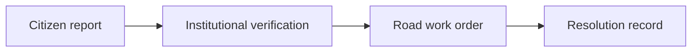

<div align="center">
  

  <h1>SadakSetu</h1>

  <p><strong>Private evidence. Public road accountability.</strong></p>

  <p>
    A privacy-conscious road reporting and resolution trail for India, built on Arkiv.
  </p>

  <p>
    <code>Arkiv Tiramisu</code>&nbsp;&nbsp;
    <code>Privacy track</code>&nbsp;&nbsp;
    <code>India use case</code>&nbsp;&nbsp;
    <code>Open source</code>
  </p>

  <p>
    <a href="#try-the-product">Run locally</a> ·
    <a href="#how-arkiv-is-used">Arkiv integration</a> ·
    <a href="arkiv/schema.md">Entity schema</a> ·
    <a href="arkiv/friction.md">Friction report</a>
  </p>
</div>

<p align="center">
  
</p>

<p align="center"><em>Report a road problem, protect the evidence, and keep the response public.</em></p>

| Citizen reporting | Privacy boundary | Public accountability | India-wide discovery |
| --- | --- | --- | --- |
| One wallet-approved Arkiv write | Exact evidence encrypted off Arkiv | Linked, read-only action records | Live reports grouped on an India map |

## Road complaints should not disappear into a ticket number

SadakSetu turns a road complaint into a public, inspectable chain of action. A citizen can report a pothole, accident, waterlogging, broken signal, debris, or another unsafe road condition. An authorised civic team can verify it, assign the work, and publish the resolution without rewriting the original report.

The public trail lives on Arkiv. Sensitive evidence does not.

That split matters. A useful civic record should show what was reported, which institution acted, and whether the road was repaired. It does not need to publish a citizen's name, phone number, exact coordinates, photo metadata, or private verifier notes.

## Four views, one public trail

| Route | Who it is for | What happens |
| --- | --- | --- |
| [`/report`](http://localhost:3000/report) | Citizens | Connect a wallet and publish a signed `road_incident` entity. |
| [`/roads`](http://localhost:3000/roads) | Everyone | Explore live Arkiv reports on an India map and inspect each public record. |
| [`/verify`](http://localhost:3000/verify) | Civic verifiers | Decrypt an evidence capsule locally and publish a signed verification decision. |
| [`/operations`](http://localhost:3000/operations) | Road authorities | Verify, assign, track, and resolve incidents through linked Arkiv entities. |

State boundaries and place suggestions are reference data bundled with the prototype. Report cards, city counts, creators, expiry blocks, and lifecycle records are read from Arkiv.

## From report to repair



Each arrow creates a new entity. SadakSetu never edits an earlier status to make the history look cleaner. Anyone inspecting the chain can see the report that was filed, the authority that verified it, the team responsible for the work, and the final resolution record.

## What stays private—and what must remain public

SadakSetu is private by data minimisation, not by pretending that a public wallet is anonymous.

### Public on Arkiv

- the signing wallet as Arkiv's `$creator`;
- a coarse road area or public junction;
- incident category, severity, and public status;
- evidence commitments and linked entity keys;
- institutional verification, assignment, and resolution history;
- creation flags and expiration blocks.

### Encrypted off Arkiv

- precise latitude and longitude;
- original photos or videos and their metadata;
- private reporter notes or reply details;
- restricted verifier notes;
- medical or emergency details.

Restricted evidence is encrypted in the browser using ephemeral ECDH P-256 key agreement and AES-256-GCM. The prototype evidence vault receives ciphertext only and expires it after at most 24 hours. The authority's private decryption key is non-exportable and remains in that browser's IndexedDB. Arkiv receives an opaque capsule ID and a SHA-256 commitment, never the plaintext or its decryption key.

The wallet that publishes a report is visible on Arkiv. The interface discloses this before signing; users should not use an address whose public linkage they do not accept.

## How Arkiv is used

SadakSetu uses Arkiv as the public coordination layer rather than as storage for personal evidence.

| Entity | Purpose | Lifetime | Public extension |
| --- | --- | ---: | :---: |
| `civic_authority` | Publishes an institution's role, jurisdiction, and encryption public key. | 365 days | No |
| `road_incident` | Records the privacy-safe incident snapshot. | 30 days | Yes |
| `incident_verification` | Records an institutional verification decision. | 180 days | Yes |
| `road_work_order` | Assigns responsibility and a service target. | 90 days | No |
| `road_resolution` | Records completion without replacing the earlier history. | 365 days | Yes |

Every entity is created with `readonly: true`. Reports, verifications, and resolutions also use `permissionlessExtension: true`, allowing the public to preserve a still-relevant accountability record without gaining permission to change it. Work orders and authority profiles remain owner-controlled.

The public API queries all five entity types at one Arkiv block, giving the UI a consistent lifecycle snapshot. If the primary RPC query quota is unavailable, it can fall back to Arkiv's experimental public index and clearly marks the response as incomplete.

The complete field-level design is documented in [`arkiv/schema.md`](arkiv/schema.md).

## Why not only Postgres or an application API?

With a conventional database, the organisation operating the application also controls the history. A complaint can be edited, hidden, reassigned, or marked resolved without leaving an independently queryable record. That is a poor trust model when the same authority may be responsible for both repairing the road and reporting its own performance.

Arkiv gives each stage a wallet-backed creator, immutable entity content, an explicit lifetime, and a public key that can be inspected outside SadakSetu. The application can present the history, but it is not the sole custodian of that history.

IPFS alone can address a file but does not provide SadakSetu's typed, attribute-based lifecycle queries. A subgraph can index chain data, but it would still require a separate contract and indexing design for entity creation, expiry, extension, and queryable properties. Arkiv provides those database-shaped primitives directly.

## Try the product

### Requirements

- Node.js 22 or newer
- Bun 1.3 or newer
- an EVM-compatible browser wallet
- test GLM from the [Tiramisu faucet](https://hub.arkiv.network/faucet)

### Install

```bash
git clone https://github.com/Vijaykv5/SadakSetu.git
cd SadakSetu
bun install
cp .env.example .env.local
```

Add the public address used by the authority wallet:

```env
SADAKSETU_AUTHORITY_OWNERS=0xYOUR_20_BYTE_EVM_ADDRESS
```

An Arkiv access key is optional but recommended for repeated server-side queries:

```env
ARKIV_API_KEY=YOUR_SERVER_SIDE_ARKIV_KEY
```

Never commit `.env.local`, and never expose the key through a `NEXT_PUBLIC_` variable.

Start the development server:

```bash
bun dev
```

Open [http://localhost:3000](http://localhost:3000).

### Tiramisu network

| Setting | Value |
| --- | --- |
| Network | Arkiv Tiramisu testnet |
| Chain ID | `7738577` |
| HTTP RPC | `https://rpc.tiramisu.db-chain.testnet.arkiv.network` |
| Explorer | [tiramisu.explorer.arkiv.network](https://tiramisu.explorer.arkiv.network/) |

SadakSetu asks the connected wallet to add or switch to Tiramisu when needed.

## Reproduce the Arkiv usage

This is the shortest path for judges to verify a real write, a live read, and the linked authority lifecycle.

### 1. Publish a citizen report

1. Open [`/report`](http://localhost:3000/report).
2. Choose a suggested road or area.
3. Enter the category, severity, and public description.
4. Click **Connect and publish road report**.
5. Connect the wallet and approve the Arkiv transaction.
6. Keep the entity key and transaction hash displayed after confirmation.

The transaction creates a real `road_incident`; it does not merely sign an off-chain message.

### 2. Read it back

Open [`/api/arkiv/roads`](http://localhost:3000/api/arkiv/roads) to inspect the block-scoped response returned by the Arkiv query. Then open [`/roads`](http://localhost:3000/roads), locate the report, and select it.

The detail page shows the entity key, creator wallet, transaction, expiry block, public attributes, and linked lifecycle records. Use **View entity** to inspect the same key independently in the Tiramisu explorer.

### 3. Publish the authority trail

Connect the funded wallet listed in `SADAKSETU_AUTHORITY_OWNERS`, open [`/operations`](http://localhost:3000/operations), and publish:

1. `civic_authority`
2. `road_incident`
3. `incident_verification`
4. `road_work_order`
5. `road_resolution`

Each approval creates a distinct read-only entity. The interface displays its entity key and explorer link.

### 4. Test expiration and extension

Choose a record marked as publicly extendable, note its expiration block, click **Extend lifetime**, and approve the transaction. Reopen the entity to confirm that its expiry moved forward while its content remained unchanged.

A successful walkthrough produces real Tiramisu transaction hashes, independently inspectable entity keys, a report returned by the live query, and a linked incident-to-resolution trail.

## Implementation map

| Area | Code |
| --- | --- |
| Wallet connection, writes, and extensions | [`lib/arkiv/wallet.ts`](lib/arkiv/wallet.ts) |
| Entity attributes and payloads | [`lib/arkiv/road-inputs.ts`](lib/arkiv/road-inputs.ts) |
| Lifetimes and creation flags | [`lib/arkiv/road-registry.ts`](lib/arkiv/road-registry.ts) |
| Block-scoped Arkiv reads | [`app/api/arkiv/roads/route.ts`](app/api/arkiv/roads/route.ts) |
| Citizen reporting flow | [`components/citizen-report-flow.tsx`](components/citizen-report-flow.tsx) |
| Authority lifecycle console | [`components/road-arkiv-console.tsx`](components/road-arkiv-console.tsx) |
| Encrypted evidence capsule | [`lib/evidence-capsule.ts`](lib/evidence-capsule.ts) |

## Technology

- Next.js 16, React 19, and TypeScript
- Tailwind CSS 4 and Lucide React
- `@arkiv-network/sdk` 0.8.1 on Tiramisu
- Viem and EIP-1193 browser wallets
- Arkiv Encryption and the Web Crypto API
- SVG for the interactive India incident map
- Bun for package management and tests

## Verify the build

```bash
bun run lint
bun run typecheck
bun test
bun run build
```

## Prototype boundaries

SadakSetu is a public prototype. It does not contact a municipality, police service, ambulance, road contractor, or emergency responder. For an active accident or medical emergency in India, call **112 first**.

The encrypted evidence vault is intentionally transient and in-memory. It demonstrates the privacy boundary but is not a production evidence service. The cryptographic design has not been independently audited.

## Project documents

- [`arkiv/schema.md`](arkiv/schema.md) — Arkiv entities, attributes, payloads, flags, and privacy boundary
- [`arkiv/friction.md`](arkiv/friction.md) — reproducible SDK and integration friction
- [`SUBMISSION.md`](SUBMISSION.md) — hackathon submission response
- [`brand.md`](brand.md) — visual system and product voice

## License

MIT — see [`LICENSE`](LICENSE).
